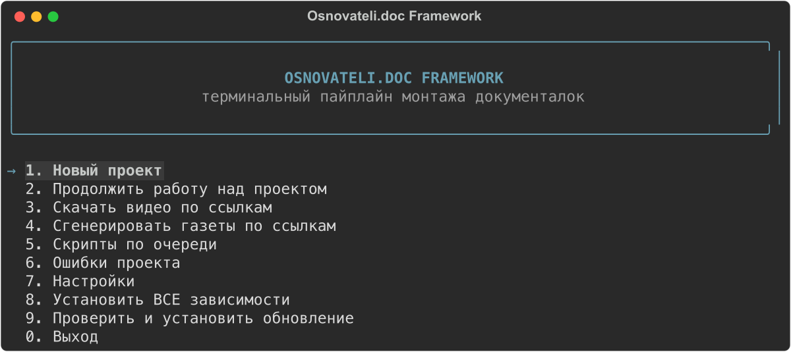

# Osnovateli.doc Framework

Терминальный пайплайн для монтажа документальных роликов: от сценария в
Google-таблице до готового набора видео/анимации/картинок — без визуального
интерфейса, полностью через терминал, без нейросетей в рантайме (только
детерминированные библиотеки).



## Что делает

По ссылке на Google-таблицу со сценарием пайплайн:

1. читает таблицу и раскладывает ссылки (YouTube-видео, MotionArray,
   картинки, статьи) по категориям;
2. скачивает всё нужное (yt-dlp для видео, обычные HTTP-запросы для
   картинок), переименовывает и кропает 16:9;
3. собирает готовые куски: анимированную «плёнку» с фотографиями блока,
   плашки с указанием источника, «газетные» статьи на рваной бумаге,
   текстовый оверлей поверх озвучки (сопоставление CSV со словами
   транскрипта — без обрезки пауз, звук не трогаем).

Проект разбит на **3 стадии**, каждая — набор подшагов:

| Стадия | Что внутри |
|---|---|
| **1. Структура и метаданные** | создание папок проекта → парсинг Google-таблицы → текстовый оверлей → обогащение YouTube-каналов (название/автор) |
| **2. Скачивание и подготовка** | картинки → YouTube-видео (yt-dlp) → переименование YouTube-видео → переименование MotionArray-видео → кроп 16:9 → PNG-плашки источников |
| **3. Упаковка** | плёнка с фото по блокам сценария → анимация плёнки (стол с фото) → статьи на рваной бумаге |

Каждый шаг **идемпотентен**: повторный запуск стадии не пересчитывает уже
готовое, а достраивает только новые/недостающие файлы (новая скачанная
картинка, новое видео, правка после ошибки — обработается только она).

## Быстрый старт

```bash
./start.sh
```

Скрипт сам найдёт подходящий Python (3.10–3.12), создаст локальное
окружение `.venv`, установит зависимости из `requirements.txt` (и
переустановит, если файл поменялся) и запустит терминальное меню.

## Главное меню

```
1. Новый проект
2. Продолжить работу над проектом
3. Скачать видео по ссылкам
4. Сгенерировать газеты по ссылкам
5. Скрипты по очереди
Q. Очередь проектов (несколько подряд, например на ночь)
6. Ошибки проекта
7. Настройки
8. Установить ВСЕ зависимости
9. Проверить и установить обновление
0. Выход
```

- **Продолжить работу над проектом** — выбор любой из 3 стадий заново;
  видно, что уже сделано (чек-лист по каждому подшагу), пересчитывается
  только новое.
- **Меню проекта** (новый или продолжаемый проект):
  - **▶ Все стадии подряд** — всё, что ещё не сделано, одним прогоном без
    вопросов между стадиями;
  - **⟳ Обновить по таблице** — перечитать таблицу (ссылка запомнена) и
    догнать всё новое: скачать, кропнуть, собрать — только то, чего ещё нет;
  - **Обзор материалов в браузере** — страница по строкам сценария: превью
    всего скачанного, чего не хватает и почему (`00_Admin/review.html`,
    обновляется после каждого прогона, есть фильтр «только проблемы»);
  - **Таймлайн для Premiere / DaVinci** — FCP7 XML
    (`01_Project_Files/<проект>_timeline.xml`): озвучка, материал каждой
    строки на её отрезке озвучки, плашки источников над видео, карточки
    текстового оверлея. Premiere: File → Import; DaVinci: File → Import →
    Timeline.
- **Очередь проектов** — выбрать несколько проектов и прогнать подряд
  (всё недоделанное или обновление по таблице). Ошибки одного проекта не
  останавливают очередь.
- **Ошибки проекта** — дашборд всех ошибок скачивания/обработки по
  стадиям, с навигацией по списку: повторить попытку, открыть ссылку в
  браузере, показать папку в Finder или убрать запись из списка (для
  заведомо мёртвых ссылок). Работает для любого типа ошибки — скачивание,
  кроп, переименование и т.д.
- **Настройки** — качество скачивания видео, папка проектов, папка
  ассетов, модель Whisper, фрагменты по таймкоду, фоновое скачивание,
  уведомления (macOS и Telegram).

## Как устроен прогон

- **Ошибка не останавливает прогон.** Упавший шаг отмечается, шаги,
  которые от него зависят, пропускаются, всё остальное выполняется. В
  конце — сводка и предложение открыть «Ошибки проекта».
- **YouTube-видео качается в фоне** (лог — `00_Admin/database/logs/`),
  пока картинки, кроп, плашки, плёнка и статьи собираются параллельно.
  Переименование видео ждёт окончания загрузки. Выключается в настройках.
- **Фрагмент вместо целого видео.** Если в ячейке сразу после ссылки
  стоит диапазон — `https://youtu.be/… 1:35-2:10` — качается только этот
  кусок. Для ссылок с `?t=` длину фрагмента (30 с / 60 с / 2 мин или
  «целиком») задаёт настройка. Файл получает метку `[t95-130]`, поэтому
  целое видео и разные фрагменты одного ролика не путаются.
- **Уведомление по окончании** прогона длиннее минуты: системное в macOS
  и в Telegram, если в настройках заданы токен бота и chat id (chat id —
  из `https://api.telegram.org/bot<токен>/getUpdates` после сообщения боту).
- **Проверить и установить обновление** — сверяет текущую версию с GitHub
  и предлагает подтянуть новую, если она есть.

## Требования

- Python 3.10–3.12
- ffmpeg
- Node.js (для генерации статей — `paper_pipeline/`)
- Google Chrome (для извлечения текста статей через puppeteer)
- Остальное — из `requirements.txt`, ставится автоматически

Раздел меню **«8. Установить ВСЕ зависимости»** проверяет и доустанавливает
всё перечисленное (включая ffmpeg, Node-зависимости `paper_pipeline`, Whisper).

## Структура проекта на диске

```
data/<название проекта>/
├── 01_структура_и_метаданные/
│   ├── database/              # CSV со ссылками, кэши
│   ├── placeholders_xml/      # текстовый оверлей поверх озвучки
│   └── voiceover/             # исходная озвучка (аудио/расшифровка)
├── 02_скачивание_и_подготовка/
│   ├── images/, images_cropped/
│   ├── video/, video_motionarray/, renamed_videos/
│   └── author/                # PNG-плашки источников
├── 03_упаковка/
│   ├── filmstrips/, filmstrip_videos/
│   └── articles/
├── errors/                    # errors/stage_<N>/<step>.csv — см. «Ошибки проекта»
├── video_direct/               # ручное скачивание по ссылкам (вне сценария)
└── gazety_direct/               # ручная генерация статей по ссылкам
```

## Код

- `core/main.py` — точка входа, терминальное меню, оркестрация стадий.
- `scripts/` — отдельные шаги пайплайна (каждый скрипт можно запустить и
  вручную) плюс общие модули: `path_utils.py` (пути проекта),
  `progress_ui.py` (единый терминальный UI на `rich` — статус-бары,
  спиннеры, панели ошибок), `error_log.py`/`errors_menu.py` (учёт и
  починка ошибок), `settings.py` (настройки), `manifest.py`
  (детектор устаревших файлов для инкрементальной пересборки),
  `project_review.py` (HTML-обзор материалов), `timeline_export.py`
  (FCP7 XML для Premiere/DaVinci), `notify.py` (уведомления),
  `youtube_utils.py` (разбор YouTube-ссылок и таймкодов).
- `scripts/text_overlay_align/` — сопоставление CSV-сценария со словами
  транскрипта и рендер текстового оверлея.
- `paper_pipeline/` — вёрстка статей на «рваной бумаге» (Node.js + puppeteer).
